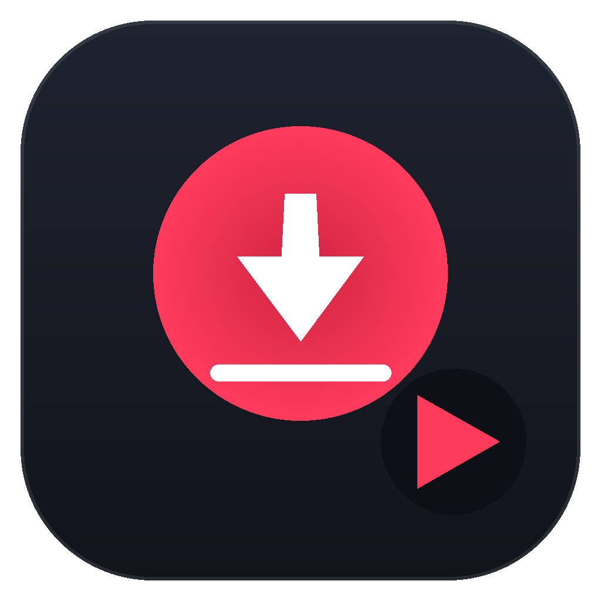

# YouTube 下载器

本地运行的 YouTube 视频下载器。双击启动，浏览器打开一个深色单页界面，粘贴链接、
挑画质、下载到底盘目录。

- **零 npm 依赖**：后端只用 Node 内置模块，前端单个 HTML 文件、不引任何 CDN 与 Web Font
- **最高 8K**：按解析结果动态列出全部可用分辨率，也可一键下整组
- **能真正躲开 403**：本地自动生成 PO Token，代理环境下依然有效
- **代理自适应**：没配代理时自动探测本机常见代理端口，探测走真实 CONNECT 握手
- **中文界面 + 人话报错**：失败时告诉你「可能原因 + 该做什么」，原始报错折叠可查

适用于 Windows 10/11。仅绑定 `127.0.0.1`，不对外网暴露。



---

## 快速开始

### 方式一：下载便携包（推荐，不用装任何东西）

1. 打开 [Releases](https://github.com/Howjump/youtube-downloader/releases) 下载最新的
   `YouTube下载器-vX.Y.Z-portable.zip`（约 93 MB）
2. 解压到任意目录（**路径可以有中文**，但不要放在 OneDrive 同步盘里，会拖慢启动）
3. 双击 `启动下载器.bat`
4. 浏览器自动打开 `http://127.0.0.1:8808`；命令行窗口保持开着即是服务在跑，`Ctrl+C` 停止

便携包内已自带 `ffmpeg`、Node.js、CPython 与 pip 版 yt-dlp，换台电脑解压即用。

### 方式二：从源码运行

从源码跑需要自己补齐第三方依赖（它们体积大且各带独立许可证，因此不进版本库）：

```powershell
git clone https://github.com/Howjump/youtube-downloader.git
cd youtube-downloader

# 自动下载 ffmpeg + 自带 CPython + pip 版 yt-dlp + PO Token 服务
powershell -NoProfile -ExecutionPolicy Bypass -File scripts\install-deps.ps1

# 检查一遍依赖是否齐（会打印一张表，缺什么一目了然）
powershell -NoProfile -ExecutionPolicy Bypass -File scripts\check-deps.ps1

# 启动
.\启动下载器.bat
```

也可以只用系统里已装好的 Node：

```powershell
npm start          # = node server.js，监听 127.0.0.1:8808
```

> `runtime/`、`bin/` 两个目录不在 git 里，`install-deps.ps1` 会把它们重新生成出来。

---

## 目录结构

```
youtube-downloader/
├── server.js                 后端：HTTP 服务 + yt-dlp 调度（2535 行，零第三方依赖）
├── public/
│   └── index.html            前端：单文件深色界面（样式与脚本全部内联）
├── 启动下载器.bat             双击启动：单窗口，前台跑 server.js
├── 启动下载器(vbs备用).vbs    备用启动器：绕过 cmd.exe 直接 Run node
├── 创建桌面快捷方式.bat/.vbs   重建桌面 + 开始菜单快捷方式
├── _diagnose.bat             双击排障：生成 _diagnose_result.txt
├── app-icon.ico/.png         程序图标（7 档尺寸 .ico + 1024 主图）
├── icon-showcase.png         各尺寸图标效果图
├── tools/                    图标与快捷方式的生成脚本（Python）
├── scripts/                  安装依赖 / 依赖自检 / 打便携包
├── docs/                     技术决策、排障手册、第三方许可
├── bin/                      ffmpeg.exe（不在 git 里，见 bin/README.md）
├── runtime/                  node / CPython / pot-server（不在 git 里）
├── downloads/                默认下载目录
├── config.json               运行时生成的本机配置（不在 git 里）
├── config.example.json       配置样例
└── package.json              npm script 入口
```

程序**不依赖任何绝对路径**：所有资源都按 `__dirname` 相对定位，整个目录可以任意搬动。

---

## 界面能做什么

| 能力 | 说明 |
|---|---|
| 画质选择 | 解析后按实际可用分辨率列出（最高 8K），每档可单选；也支持「全部下载」下整组 |
| 纯音频 | MP3（VBR 最高音质）或原始音轨（AUDIO-NATIVE，不转码） |
| 兼容 / 画质优先 | 两种排序策略：H.264（任何播放器都能放）或 AV1/VP9（体积更小） |
| 封装格式 | MP4 或 MKV |
| 并发队列 | 默认 2，可设 1–6；排队、下载中、完成、失败各自成卡片 |
| 实时进度 | SSE 推送，含速度、剩余时间、分片进度 |
| 封面 | 下载并统一转成 jpg（YouTube 多为 webp，剪映等软件不认）；可嵌入成品 |
| 字幕 | 自动字幕 + 人工字幕，转 srt，语言列表可配 |
| 元数据 | 标题、作者、日期、封面嵌入 |
| 播放列表 | 默认关闭，可显式打开 |
| 限速 | 支持 yt-dlp `--limit-rate` 语法（如 `5M`） |
| 代理 | 手填 HTTP/SOCKS，或留空让程序自动探测本机常见代理端口 |
| cookies | 可从 Chrome / Edge / Firefox / Brave 读取（浏览器需先完全退出） |
| 更新 yt-dlp | 界面上一键升级到最新 pip 版；版本超过 45 天会亮黄标提醒 |
| 打开位置 | 下载完可直接打开文件夹并选中文件 |

---

## 配置说明

首次启动会自动生成 `config.json`。**推荐在界面「设置」里改**，只有要用脚本批量改时才手改文件。
想从零开始，直接删掉 `config.json` 重启即可（会按默认值重建）。

| 键 | 默认值 | 说明 |
|---|---|---|
| `downloadDir` | 程序目录下的 `downloads` | 下载目录。写相对路径时相对启动时的工作目录 |
| `proxy` | `""` | 代理地址，如 `http://127.0.0.1:7890` 或 `socks5://127.0.0.1:1080`。留空 = 先试直连，再自动探测 |
| `preferHighQuality` | `false` | `false` = 兼容优先（H.264）；`true` = 画质优先（AV1/VP9） |
| `mergeContainer` | `mp4` | 音视频合并容器，`mp4` 或 `mkv` |
| `embedMetadata` | `true` | 嵌入标题/作者/日期等元数据 |
| `writeThumbnail` | `false` | 是否下载封面文件（任务级可单独覆盖） |
| `embedThumbnail` | `false` | 是否把封面嵌进成品（会自动确保封面文件存在） |
| `writeSubtitles` | `false` | 是否下载字幕 |
| `subtitleLangs` | `zh-Hans,zh-CN,zh,en` | 字幕语言优先级 |
| `cookiesFromBrowser` | `""` | `chrome` / `edge` / `firefox` / `brave`，留空不用 |
| `concurrency` | `2` | 同时下载任务数 |
| `filenameTemplate` | `%(title).120B [%(id)s].%(ext)s` | yt-dlp 文件名模板，默认会把标题截到 120 字节 |
| `allowPlaylist` | `false` | 是否允许下载整个播放列表 |
| `rateLimit` | `""` | 限速，如 `5M`、`800K` |
| `potProviderUrl` | `http://127.0.0.1:4416` | PO Token 服务地址（HTTP 退路，一般用不到） |
| `userAgent` | `""` | 自定义 UA，配合 cookies 可降低风控概率 |
| `playerClient` | `""` | YouTube 客户端声明。**建议留空**，交给 yt-dlp 自己挑，详见 [技术决策](docs/技术决策.md) |

> `downloadDir` 写成绝对路径最省心，例如 `"D:\\视频\\YouTube"`（JSON 里反斜杠要写两个）。

---

## 端口

| 端口 | 用途 |
|---|---|
| `8808` | 主界面与 API。可用环境变量 `PORT` 改，如 `set PORT=9000` 后再启动 |
| `4416` | PO Token 服务的 HTTP 模式（**仅作退路**）。默认走本地脚本模式，不需要这个端口 |

---

## 常见问题

**只解析出 1 档、最高 360p？**
几乎都是 PO Token 没生效。多半是 `runtime\pot-server\build\generate_once.js` 缺失（或缺 pip 版的
插件）。跑一次 `scripts\check-deps.ps1` 看 PO Token 那一行，或者直接用 Release 便携包。
注意 `bin\yt-dlp.exe` 独立版**不加载插件**，拿不到令牌，所以程序优先走 pip 版。

**解析正常，但下载到一半 403？**
按这个顺序查：① yt-dlp 版本是不是超过 45 天（界面会提示，点一下就能升级）→ ② 换代理节点
→ ③ 最后才考虑 cookies。别一上来就折腾 `playerClient`。

**提示「Sign in to confirm you're not a bot」？**
先升级 yt-dlp，再换出口 IP。实测换了线路仍失败时，升级版本往往一次解决。

**解析半天没反应？**
多半是直连被墙、又没配代理。程序会自动探测常见代理端口（7890/7897/10809/1080/10090 等，
探测是发真实 CONNECT 请求），探不到就一路等到超时。在设置里填上代理地址即可。

**下载完成但只有画面没声音 / 声音是外语？**
自动配音音轨的坑，已在 2026-10-27 修复（排序键把 `lang` 放在 `br` 之前）。如果你手里的
是旧版本下载的文件，可以只重下原声音轨再合成，[技术决策](docs/技术决策.md) 里有 ffmpeg 命令。

**提示找不到 Node.js？**
`启动下载器.bat` 会按 `runtime\node\node.exe` → `bin\node.exe` → 系统安装路径 依次找。装个
Node.js LTS 最省事。

更多排障见 [docs/常见问题.md](docs/常见问题.md)。

---

## 打便携包 / 发布

```powershell
npm run package
# 或：powershell -NoProfile -ExecutionPolicy Bypass -File scripts\package-portable.ps1
```

产物在 `dist\YouTube下载器-v1.0.0-portable.zip`，里面包含源码、`bin\ffmpeg.exe`、
`runtime\node`、`runtime\python`、`runtime\pot-server` 以及一份 `使用说明.txt`。
把它作为一个 Release 的附件上传即可——**不要提交进 git**，仓库只放源码。

---

## 技术文档

- [docs/技术决策.md](docs/技术决策.md) —— 每一条反直觉写法的原因（403、PO Token、音轨串台、
  代理环境变量、.bat 行尾……）。**改代码前先读这个**，里面记着「删了就废」的决策。
- [docs/常见问题.md](docs/常见问题.md) —— 用户视角的排障手册
- [docs/第三方组件与许可.md](docs/第三方组件与许可.md) —— 便携包内各组件来源与许可证

---

## 免责声明

本项目仅供**个人学习与技术研究**使用，请勿用于任何商业用途或大规模抓取。

下载的视频、音频、字幕的**版权归原始权利人所有**。使用者应自行确认其行为符合所在地区的
法律法规以及 YouTube 服务条款；因使用本项目产生的一切后果由使用者自行承担。

本项目不提供任何规避付费墙、DRM 或会员限制的功能。

---

## 许可

本仓库自写代码（`server.js`、`public/`、`tools/`、启动器与文档）采用 [MIT](LICENSE) 许可。
便携包内附带的第三方组件遵循各自的原始许可证，详见
[docs/第三方组件与许可.md](docs/第三方组件与许可.md)。

## 致谢

- [yt-dlp](https://github.com/yt-dlp/yt-dlp) —— 真正干活的部分
- [bgutil-ytdlp-pot-provider](https://github.com/Brainicism/bgutil-ytdlp-pot-provider) —— PO Token 生成
- [FFmpeg](https://ffmpeg.org/) —— 合并与转码
